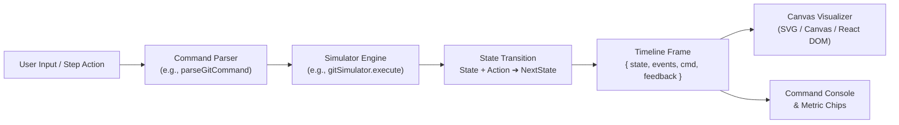

# 🛠️ Engineering Playground

<div align="center">

[](https://nextjs.org/)
[](https://react.org/)
[](https://www.typescriptlang.org/)
[](https://tailwindcss.com/)
[](https://pnpm.io/)
[](#license)

**An interactive visual learning platform and simulation lab for core software engineering and DevOps technologies.**

*Learn Git, Docker, Kafka, Kubernetes, Networking, and CI/CD by executing commands and seeing the exact state changes in real time.*

[Features](#-key-features) • [Curriculum](#-curriculum--learning-tracks) • [Simulation Architecture](#-simulation-architecture) • [Quickstart](#-quickstart) • [Project Structure](#-project-structure) • [Extending](#-extending-lessons--simulators)

</div>

---

## 🌟 Overview

**Engineering Playground** eliminates the guesswork of distributed systems, container orchestration, and version control. Rather than relying on static slides or abstract diagrams, it provides **in-browser, deterministic simulators** that model internal system mechanics step-by-step.

Every CLI command you type updates an underlying state machine and renders an animated visualization—showing pointers moving in a Git DAG, container layers stacking in Docker, partitions balancing across Kafka brokers, or packets negotiating a TLS 1.3 handshake.

---

## ✨ Key Features

### 1. 🎯 Interactive Guided Lessons (`/learn`)
Step-by-step interactive walk-throughs across 6 technical domains. Each step includes:
- **Concept & Key Ideas**: Clear, jargon-free explanations of core mechanics.
- **Visual State Evolution**: Step-by-step transitions with rewind, step forward, auto-play, and replay controls.
- **Embedded Sandbox**: An interactive terminal prompt where you can test commands freely before moving to the next step.
- **Categorized Tags**: Lessons clearly tag each stage by `CONCEPT`, `TECHNIQUE`, `PITFALL`, `PRACTICE`, or `RECAP`.

### 2. 🔬 The Simulation Lab (`/lab`)
A freeform sandbox environment where you can freely spin up, break, and inspect systems without risk:
- **6 Simulators**: Switch between Git, Docker, Kafka, Kubernetes, Networking, and CI/CD on the fly.
- **Interactive Command Console**: Live syntax parser with feedback, command history, and auto-scrolling terminal logs.
- **Deep State Inspector**: Collapsible live JSON state viewer showing exact internal memory structures.
- **Quick Scenarios**: One-click preset topologies (e.g., diverged branches, multi-broker topics, 3-node Kubernetes clusters).

### 3. 🏆 Hands-On Challenges (`/challenges`)
Scenario-based engineering puzzles categorized from **Beginner** to **Advanced**:
- Real-world failure modes and operations (e.g., linear rebasing, container port mapping, Kafka lag reduction, rolling zero-downtime updates).
- Live criteria verification that tests your simulator state against target requirements.
- Progressive hints for guided problem solving.

### 4. 📖 Deep-Dive Cheatsheets (`/cheatsheets`)
Searchable, battle-tested CLI reference guides:
- Syntax patterns for real-world day-to-day operations.
- Operational tips and common pitfalls.
- One-click clipboard copy.

### 5. 🔊 Sensory Audio Feedback
Integrated Web Audio API synthesizer (`lib/tones.ts`) generating subtle, pleasant sound tones on command execution, success transitions, and errors.

### 6. 🎨 High-Craft UI & Developer Aesthetic
- Built using **Tailwind CSS v4** and `@base-ui/react`.
- Fluid animations powered by **Motion**.
- Dark and light theme modes with high-contrast typography in **JetBrains Mono**.

---

## 📚 Curriculum & Learning Tracks

| Domain | Topic / Lesson | Key Concepts & Mechanics Covered |
| :--- | :--- | :--- |
| **Git** | **Branching & Merging** | Commits as immutable snapshots, branch pointers, `HEAD`, 3-way merge commits vs. fast-forward. |
| **Git** | **Rebase, Step by Step** | Replaying commit deltas onto upstream branches, rewriting commit SHAs, linear history. |
| **Git** | **Resolving Conflicts** | 3-way conflict markers, staging resolutions, aborting vs. continuing rebase/merge. |
| **Git** | **Cherry-Pick & Stashing** | Surgical commit grafting across branches, index stashing, dirty working tree preservation. |
| **Docker** | **From Image to Container** | Content-addressable image layers, copy-on-write (CoW) container layer, volume mounting, port forwarding. |
| **Docker** | **Compose Multi-Service Apps** | Defining multi-container topologies, custom bridge networks, service discovery via container DNS. |
| **Kafka** | **Topics, Partitions & Offsets** | Commit logs, record offsets, key-based partitioning, consumer group rebalancing, and consumer lag. |
| **Kafka** | **Replication & Failover** | Broker clusters, In-Sync Replicas (ISR), partition leader election, and high-availability broker failure. |
| **Kubernetes** | **Pods & Deployments** | Pod lifecycle, desired vs. actual state reconciliation loops, replica sets, rolling update deployments. |
| **Kubernetes** | **Services & Scheduling** | ClusterIP & NodePort routing, label selectors, kube-proxy, and node affinity scheduling. |
| **Networking** | **DNS Resolution** | Recursive resolvers, root hints, TLD servers, authoritative name servers, and caching TTLs. |
| **Networking** | **TCP & TLS Handshakes** | TCP 3-way handshake (`SYN` → `SYN-ACK` → `ACK`), TLS 1.3 key exchange, cipher negotiation, and secure channel setup. |
| **CI/CD** | **Pipelines & Artifacts** | Directed Acyclic Graph (DAG) pipelines, parallel job execution, build caching, and artifact promotion. |

---

## 🏗️ Simulation Architecture

The core of Engineering Playground is built on **pure, deterministic state machines** (`lib/sim/`). The visualization layer renders reactive snapshots derived directly from the simulator state:



### Simulator Engines:
- **`lib/sim/git.ts`**: Models commits (SHA-1 hash, tree pointer, parents), branch refs, HEAD pointer, staging index, and working tree.
- **`lib/sim/docker.ts`**: Models daemon state, image cache, layered filesystem, containers, bridge network links, and port bindings.
- **`lib/sim/kafka.ts`**: Models broker nodes, partition leaders/followers, log segments with monotonically increasing offsets, and consumer group commit pointers.
- **`lib/sim/k8s.ts`**: Models cluster nodes, pods, replica sets, deployments, services, and selector-based traffic forwarding.
- **`lib/sim/networking.ts`**: Models packet sequences, protocol state machines (TCP flags, TLS records), and DNS query-response hierarchies.
- **`lib/sim/cicd.ts`**: Models stages, jobs, dependency edges, execution queues, log buffers, and generated build artifacts.

---

## 📂 Project Structure

```text
├── app/
│   ├── challenges/        # Hands-on challenge scenarios & verification engine
│   ├── cheatsheets/       # Interactive command cheatsheets & tips
│   ├── lab/               # Sandbox playground for all 6 simulation systems
│   ├── learn/             # Guided interactive lesson player routes
│   │   └── [lessonId]/    # Dynamic lesson view by step
│   ├── globals.css        # Tailwind CSS v4 design tokens and retro styles
│   └── layout.tsx         # Root app layout, font configuration, and metadata
├── components/
│   ├── playground/        # Shell components (header, player, console, metrics)
│   │   └── viz/           # Custom canvas visualizers:
│   │       ├── cicd-pipeline.tsx
│   │       ├── docker-host.tsx
│   │       ├── git-graph.tsx
│   │       ├── k8s-cluster.tsx
│   │       ├── kafka-cluster.tsx
│   │       └── network-flow.tsx
│   └── ui/                # Base UI and primitives
├── hooks/
│   └── use-playback.ts    # Timeline player hook (play, pause, step, seek)
├── lib/
│   ├── lessons/           # Lesson definitions, step bodies, and course catalog
│   ├── sim/               # In-memory simulators, state machines, and parsers
│   ├── tones.ts           # Web Audio API sound synthesizer
│   └── utils.ts           # Utility helpers (cn, class merging)
└── public/                # Static assets, icons, and illustrations
```

---

## 🚀 Quickstart

### Prerequisites

- **Node.js**: `v20.x` or later
- **pnpm**: `v9.x` or later (or `corepack enable pnpm`)

### 1. Clone the repository

```bash
git clone https://github.com/your-username/engineering-playground.git
cd engineering-playground
```

### 2. Install dependencies

```bash
pnpm install
```

### 3. Start the development server

```bash
pnpm dev
```

The application will be live at `http://localhost:4500` (or `http://0.0.0.0:4500`).

---

## 📦 Available Scripts

| Command | Description |
| :--- | :--- |
| `pnpm dev` | Starts the Next.js development server on port 4500 |
| `pnpm build` | Builds an optimized production bundle |
| `pnpm start` | Runs the production build server on port 4500 |

---

## 🧩 Extending Lessons & Simulators

### Adding a New Lesson

1. **Create the lesson file** in `lib/lessons/<your-lesson>.ts`:
   ```typescript
   import type { Lesson } from './types'
   import { gitSimulator } from '@/lib/sim/git'

   export const myNewLesson: Lesson = {
     id: 'my-lesson-id',
     domainId: 'git',
     title: 'Mastering Git Worktrees',
     subtitle: 'Manage multiple working trees attached to the same repository.',
     simulator: gitSimulator,
     metrics: (state) => [ /* metric chips */ ],
     steps: [
       {
         label: 'Step 1',
         title: 'What is a Worktree?',
         tag: 'CONCEPT',
         body: ['Worktrees allow you to check out multiple branches at once...'],
         actions: [],
       },
     ],
   }
   ```

2. **Register the lesson** in `lib/lessons/catalog.ts`:
   - Import your lesson definition.
   - Add it to the `lessons` map and the relevant `domains` entry.

3. **Provide Custom Visualization (Optional)**:
   - Connect the simulator's events and state to existing visualizers in `components/playground/viz/` or create a new dedicated component.

---

## 🛠️ Tech Stack

- **Framework**: [Next.js 16](https://nextjs.org/) (App Router, Turbopack)
- **Library**: [React 19](https://react.dev/)
- **Styling**: [Tailwind CSS v4](https://tailwindcss.com/)
- **Animation**: [Motion](https://motion.dev/)
- **UI Components**: [@base-ui/react](https://base-ui.com/) & [Lucide Icons](https://lucide.dev/)
- **Typography**: [JetBrains Mono](https://www.jetbrains.com/lp/mono/)
- **Audio Engine**: Custom Web Audio API synthesizer
- **Analytics**: [@vercel/analytics](https://vercel.com/analytics)

---

## 🤝 Contributing

Contributions are welcome! If you'd like to add new lessons, enhance visualizers, or create new simulators:

1. Fork the repository.
2. Create your feature branch (`git checkout -b feature/amazing-lesson`).
3. Commit your changes (`git commit -m 'Add interactive WebSockets lesson'`).
4. Push to the branch (`git push origin feature/amazing-lesson`).
5. Open a Pull Request.

---

## 📄 License

This project is licensed under the MIT License — see the [LICENSE](LICENSE) file for details.
